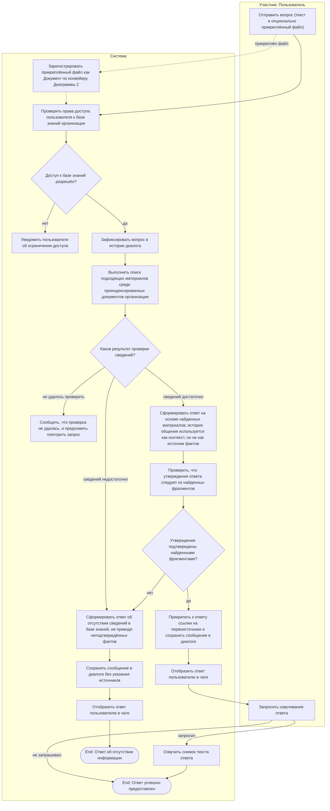
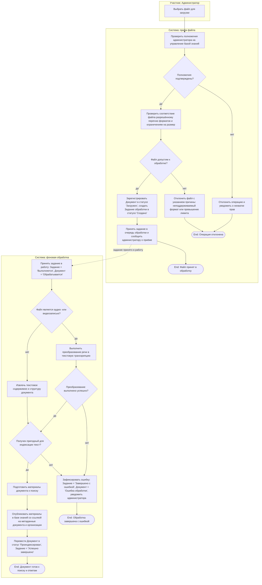
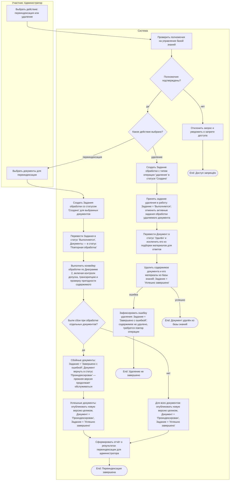

# Задание №3. Диаграммы деятельности (Activity Diagram)

**Автор:** Ваджипов Эмир · ветка `emir-task3-refinement` · папка `1-task/3/`
**Основа:** Vision & Scope (`1-task/1/`), UseCase-диаграмма (`1-task/2/`), глоссарий и бизнес-правила (`1-task/4/task.md`)
**Цель шага:** смоделировать сценарии действий пользователей и системы на уровне бизнес-процессов предметной области и выявить правила и ограничения, выведенные при моделировании.

## Что сделано

Смоделированы три бизнес-процесса из UseCase-диаграммы (`1-task/2/diagram.png`):

1. **Сценарий ответа на вопрос пользователя** — прецедент `Задать вопрос` и обязательное включение `<<include>>` `Сформировать ответ по контексту`: проверка доступа, поиск материалов, различение исходов «сведений достаточно / недостаточно / проверить не удалось», формирование ответа с источниками, озвучивание.
2. **Сценарий загрузки и обработки документа** — прецедент `Загрузить документ в базу знаний` и опциональное расширение `<<extend>>` `Транскрибировать медиафайл`: допуск файла, регистрация документа и задания обработки, фоновая обработка с единой проверкой пригодности содержимого.
3. **Сценарий актуализации и удаления материалов базы знаний** — прецеденты `Запустить переиндексацию базы знаний` и `Удалить документ из базы знаний`: повторная обработка с публикацией новой версии и удаление как отменяемая операция.

Диаграммы построены на Mermaid `flowchart` с разделением на дорожки **Участник** и **Система**. Mermaid не имеет собственного типа «activity diagram», поэтому дорожки реализованы через `subgraph` — соответствие нотации задания разобрано в разделе «Формат и нотация».

## Цели и не-цели шага

**Цели**

* Зафиксировать бизнес-процессы ответа на вопрос, обработки документа и актуализации базы знаний на уровне действий участников и реакции системы.
* Выявить правила и ограничения, которые следуют из самих процессов, и указать для каждого правила точку проверки.
* Разграничить ответственность участников и системы.

**Не-цели**

* Низкоуровневые детали реализации: конкретные хранилища, форматы хранения, параметры поиска, механизмы разбиения на фрагменты, кодовые ошибки и названия внутренних компонентов.
* Проектирование интерфейсов, схем данных и сигнатур — это задание №6 и последующие.
* Техническая реализация внешних AI-сервисов: в диаграммах они показаны как **внешняя система**, доступная по сети, и могут отказать.

## Граница охвата

Смоделированы три процесса из девяти прецедентов UseCase-диаграммы. Нижеперечисленное **намеренно не смоделировано** в рамках этого шага:

| Не смоделировано | Причина |
|---|---|
| `Просмотреть историю диалогов` | Просмотр сохранённой истории — отдельный прецедент, не входящий в сценарий ответа |
| `Управлять пользователями` | Управление учётными записями не относится к процессам базы знаний |
| `Настроить виджет встраивания` | Настройка виджета — конфигурация, а не бизнес-процесс; **BR13** (виджет использует настройки и базу знаний своей организации) в этом шаге не имеет процесса, см. «Отклонения и открытые вопросы» |
| `Прикрепить файл в чат` | Частично отражён: файл проходит допуск и регистрируется как Документ, но в текущем ответе не участвует (см. Диаграмму 1) |

Правила **BR13**, а также по-документные права доступа (см. «Отклонения и открытые вопросы») остаются без собственного процесса в этом шаге.

## Конвенция гарантий

Нормативными в этом документе являются **графы**. Текст не может утверждать больше, чем моделирует граф. Каждое нормативное утверждение разлагается на тройку:

1. **узел-гейт**, в котором утверждение проверяется;
2. **явный исход при неуспехе** — что именно происходит, когда проверка не пройдена;
3. **носитель состояния**, в котором наблюдается результат.

Если тройки нет — утверждение либо ослабляется до утверждения об объёме, либо в граф добавляется узел. Правило проверяется **в одной точке**; если требование упоминается в двух местах, это признак двух реализаций одного правила.

---

## Диаграмма 1. Сценарий ответа на вопрос пользователя

Покрывает прецеденты: `Задать вопрос` + обязательное включение `<<include>>` `Сформировать ответ по контексту`.
Частично отражены: `Прикрепить файл в чат` (регистрация файла как документа), `Прослушать ответ` (озвучивание по отдельному запросу).
Связанные бизнес-правила: **BR1, BR2, BR3, BR4, BR9, BR10, BR12, BR14**.

### Бизнес-логика сценария

* Права проверяются до любых действий с материалами; при отказе вопрос не фиксируется в истории (**BR2, BR3**).
* Прикреплённый в чате файл проходит тот же допуск и регистрируется как Документ, но **не участвует в текущем ответе**: в поиск попадают только документы в статусе `Проиндексирован` (**BR1, BR4**). Отдельная обработка файла идёт по Диаграмме 2.
* Поиск выполняется только среди проиндексированных документов организации (**BR1, BR4**).
* Итог проверки сведений трёхзначен: сведений достаточно, сведений недостаточно, **проверка не удалась**. Технический сбой не публикуется как утверждение о содержимом базы знаний — пользователь получает отдельное сообщение (**BR9**).
* Корпоративные факты в ответе опираются **только** на найденные материалы. История общения поступает как контекст и источником фактов не является: иначе прежний неподтверждённый ответ стал бы свидетельством в следующем ходе (**BR9, BR10**).
* Ответ, чьи утверждения не следуют из найденных фрагментов, в выдачу не попадает — срабатывает ветка «сведений недостаточно» (**BR9**).
* Ответ, сформированный из найденных материалов, сопровождается указанием использованных документов и фрагментов (**BR10**). Ответ об отсутствии сведений сохраняется без ссылок — но сопровождается отметкой о том, какие материалы были проверены.
* Вопросы и ответы, обработанные в диалоге, сохраняются в его истории — это продуктовое решение (Vision & Scope, §3 «Хранение и просмотр истории диалогов»), а не следствие BR12.
* Озвучивание выполняется по отдельному запросу пользователя и воспроизводит неизменяемый снимок текста ответа, поэтому аудиоверсия соответствует именно выданному тексту (**BR14**).

---

## Диаграмма 2. Сценарий загрузки и обработки документа

Покрывает прецеденты: `Загрузить документ в базу знаний` + опциональное расширение `<<extend>>` `Транскрибировать медиафайл`.
Связанные бизнес-правила: **BR1, BR4, BR5, BR6, BR11, BR15**.

### Бизнес-логика сценария

* Управление базой знаний доступно исключительно авторизованным администраторам (**BR11**).
* Допустимость файла проверяется по разрешённому перечню форматов (Vision & Scope, §4 «Ограничение по форматам») и по ограничениям на размер. BR5 при этом остаётся правилом о приведении **типов материалов** к пригодной форме, а не о белом списке.
* Приём файла фиксируется сразу и завершается отдельным исходом «Файл принят в обработку»; сама обработка идёт в фоне, вне потока администратора. Статусы Документа (`Загружен → Обрабатывается → Проиндексирован / Ошибка обработки`) и Задания обработки (`Создано → Выполняется → Успешно завершено / Завершено с ошибкой`) наблюдаемы администратором (**BR15**).
* Аудио- и видеоматериалы обязательно проходят транскрипцию до индексации (**BR6**).
* **Проверка пригодности содержимого одна и общая для обеих ветвей** — после извлечения текста и после транскрипции. Документ без пригодного содержимого (пустой файл, тишина в записи, транскрипция шума) не публикуется: обработка считается неуспешной, фиксируется ошибка (**BR4, BR15**).
* Публикация материалов — единственная точка, в которой документ становится доступным для поиска (**BR1**). До неё документ в поиске не участвует (**BR4**).

---

## Диаграмма 3. Сценарий актуализации и удаления материалов базы знаний

Покрывает прецеденты: `Запустить переиндексацию базы знаний`, `Удалить документ из базы знаний`.
Связанные бизнес-правила: **BR7, BR8, BR11, BR15**.

### Бизнес-логика сценария

* Операции актуализации и удаления доступны только администраторам (**BR11**).
* **Переиндексация повторяет конвейер обработки Диаграммы 2**, а не отдельный путь: контроли допуска, транскрипция и проверка пригодности содержимого наследуются. Поэтому переиндексируемый аудио- или видеофайл не может быть опубликован без транскрипции (**BR6**), а документ без пригодного содержимого — опубликован (**BR4**).
* **Окно доступности при переиндексации:** ранее опубликованная версия документа продолжает обслуживать запросы, новая версия готовится отдельно и публикуется по успеху. Смешения версий не происходит — замена целиком, а не дописывание (**BR8**). Состояние документа `Повторная обработка` показывает администратору незавершённость обновления (**BR15**), но не выводит материал из выдачи.
* При сбое переиндексации отдельных документов прежняя версия продолжает обслуживаться, а ошибка фиксируется на Задании: неудачное обновление не отнимает у пользователя рабочий материал. Сбойные и успешные документы обрабатываются раздельно (**BR8, BR15**).
* **Удаление — операция с типом в существующей сущности «Задание обработки»**: она отменяет активные задания документа, исключает его из подборки материалов и только затем удаляет содержимое. Активное задание не может вернуть удалённый материал в выдачу (**BR7**). Статус задания удаления наблюдаем администратором наравне с заданиями обработки (**BR15**).
* После исключения из подборки документ недоступен для формирования **новых** ответов. Ответы, сформированные до удаления, и сохранённые сообщения со ссылками на удалённый документ остаются в истории диалога — это осознанное ограничение, см. «Риски и ограничения».
* Результаты операций и статусы обработки отображаются администратору (**BR15**).

---

## Правила: точка проверки, исход при неуспехе, носитель состояния

| Правило | Узел-гейт | Исход при неуспехе | Носитель состояния |
|---|---|---|---|
| **BR1** — в выдаче только успешно обработанное | `V1` «Опубликовать материалы» (Д2); `B6`/`B7` (Д3) | Публикация не выполняется; документ сохраняет прежнюю опубликованную версию | Статус Документа; факт публикации |
| **BR2** — доступ к базам знаний | `B1` «Проверить права доступа» (Д1) | `E_NO_AUTH` — уведомление об ограничении, вопрос не фиксируется | — (решение об отказе) |
| **BR3** — изоляция данных организаций | `B1` (Д1) и поиск по материалам своей организации (Д1, `R1`) | Материалы других организаций в выдачу не попадают | Принадлежность опубликованных материалов |
| **BR4** — до завершения обработки не используется | `D4` «Получен пригодный для индексации текст?» → `V1` | `F1` — ошибка обработки, публикация не выполняется | Статус Документа |
| **BR5** — типы материалов приведены к пригодной форме | `D2`/`D3` (транскрипция), `D4` (пригодность) | `F1` | Статус Документа |
| **BR6** — речь преобразована в текст до использования | `D3` «Преобразование выполнено успешно?» | `F1` | Статус Документа |
| **BR7** — удалённое не используется в новых ответах | `B9` «Отменить активные задания», `B10` «Исключить из подборки» | `F2` — ошибка удаления, содержимое не удалено, требуется повтор | Статус Документа `Удалён`; признак исключения из подборки |
| **BR8** — устаревшее заменено актуальным | `B6`/`B7` «Опубликовать новую версию целиком» | `B5` — прежняя версия продолжает обслуживаться | Опубликованная версия документа |
| **BR9** — не выдумывать корпоративные факты | `B7` «Проверить, что утверждения следуют из фрагментов» | Утверждения не подтверждены → ветка «сведений недостаточно»; проверка не удалась → `E_FAIL` | Сообщение в диалоге |
| **BR10** — сохранена возможность определить использованные материалы | `B8` «Прикрепить ссылки на первоисточники» | Ответ без источников не публикуется; для отказа фиксируется перечень проверенных материалов | Ссылки в сообщении; отметка о проверенных материалах |
| **BR11** — управление базой знаний только для администраторов | `B1` «Проверить полномочия администратора» (Д2), `B1` (Д3) | `E_NO_PERM` / `E_NO_PERM` | — (решение об отказе) |
| **BR12** — сообщения могут сохраняться в диалоге | `B2` «Зафиксировать вопрос в истории диалога» | — | История диалога |
| **BR13** — виджет использует настройки и базу знаний своей организации | *вне объёма шага* — см. «Отклонения и открытые вопросы» | — | — |
| **BR14** — аудиоверсия соответствует текстовому ответу | `A3` «Озвучить снимок текста ответа» | Отказ озвучивания не отменяет выданный текстовый ответ | Снимок текста ответа |
| **BR15** — состояние обработки определимо администратором | `RPT` «Отчёт о результатах переиндексации», статусы Документа и Задания | `F1`, `F2` — ошибка фиксируется в статусе и уведомляется администратору | Статусы Документа и Задания обработки |

## Решения и отвергнутые альтернативы

| Решение | Отвергнутая альтернатива | Компромисс выбранного варианта |
|---|---|---|
| Публикация материала — только по успеху обработки | Фильтр по статусу документа при каждом поиске | Публикация требует явного действия по завершении, но поиск всегда видит только опубликованное и не требует сверки статуса на каждый запрос |
| Прежняя версия документа продолжает обслуживать запросы во время переиндексации | Документ уходит из выдачи до завершения обновления | Нет простоя в обслуживании, но требуется хранить версии и отслеживать устаревание |
| Замена содержимого целиком, без смешения версий | Поэлементная замена с частичным применением | Всё или ничего, но требуется транзакционность публикации |
| Переиндексация повторяет конвейер обработки | Отдельный упрощённый путь переиндексации | Контроли не расходятся, но переиндексация дороже по ресурсам |
| Удаление — задание обработки с отменой активных заданий | Немедленное удаление в запросе | Удаление наблюдаемо и имеет ветвь отказа, но требует механизма отмены заданий |
| Права проверяются на уровне базы знаний организации | По-документные права доступа | Проще и покрывает текущие потребности, но не даёт разграничения внутри организации — см. «Отклонения и открытые вопросы» |
| Обработка выполняется в фоне, статус виден администратору | Синхронная обработка в запросе | Требует ожидания в очереди, но не блокирует интерфейс и даёт наблюдаемый статус |
| История общения — контекст, но не источник фактов | История общения как равноправный источник | Возможны ответы без источников в части контекста, но исключается самоподкрепление неподтверждённых фактов |
| Отсутствие сведений и невозможность проверки — разные исходы | Единый исход «информации нет» | Появляется отдельное сообщение об ошибке, но авария не публикуется как факт о базе знаний |

## Риски и ограничения

**Отказы фоновой обработки.** Задание может не завершиться: сбой исполнителя, нечитаемый документ, недоступность внешней AI-системы. Предусмотрено: фиксация ошибки в статусе Задания и уведомление администратора (**BR15**). Не предусмотрено на этом шаге: автоматическая повторная обработка и восстановление зависших заданий — это задача реализации.

**Частичная переиндексация.** Сбой отдельных документов не влияет на успешные: прежние версии продолжают обслуживаться, ошибка изолирована на Задании (**BR8**).

**Конкурентные операции.** Удаление документа и его переиндексация, выполненные одновременно, разрешаются тем, что удаление отменяет активные задания документа (**BR7**).

**Безопасность.** Проверка прав администратора выполняется до допуска файла (**BR11**). Изоляция организаций обеспечивается принадлежностью публикуемых материалов (**BR3**). Загруженные документы могут содержать инструкции, адресованные модели, — обработка таких документов требует проверки со стороны реализации; на уровне бизнес-процесса это ограничение зафиксировано, но не снято.

**Приватность.** Удаление документа исключает его из подборки и удаляет содержимое, но не удаляет ранее сформированные ответы и сохранённые сообщения со ссылками на него: история диалога остаётся. Это осознанное ограничение — при полном удалении нужно затронуть историю диалогов, что выходит за объём текущего прецедента.

**Масштабируемость.** Длительность транскрипции длинных аудио- и видеоматериалов, стоимость внешних AI-сервисов на один ответ и задержка очереди обработки ограничивают пропускную способность. Правила дедупликации при повторной загрузке того же файла на этом шаге не зафиксированы.

## Отклонения от базовых документов и открытые вопросы

Эти пункты требуют решения авторами базовых документов (`1-task/1/`, `1-task/4/`) и **намеренно не правятся в рамках этого задания** — они зафиксированы здесь, чтобы расхождения были видимы.

1. **BR2** сформулирован как доступ «к базам знаний **и документов**». В этом шаге смоделирована проверка на уровне базы знаний: по-документные права доступа — новая архитектурная компонента, не вытекающая из требований. Требуется либо уточнить BR2, либо вынести по-документный доступ за объём версии.
2. **BR12** сформулирован разрешительно («сообщения **могут** сохраняться»). Здесь сохранение истории заявлено как продуктовое решение со ссылкой на Vision & Scope, §3 «Хранение и просмотр истории диалогов». BR12 при этом не расширяется, а трактуется.
3. **Ограничение на размер файла** не зафиксировано ни в Vision & Scope, ни в бизнес-правилах, но проверяется в процессе и упоминается в сообщении об отказе. Требуется внести в базовый документ или убрать из бизнес-процесса.
4. **BR13** (виджет) не имеет процесса в этом шаге — см. «Граница охвата».
5. **Перечень форматов** берётся из Vision & Scope, §4 «Ограничение по форматам», а не из BR5 — BR5 остаётся правилом о приведении типов материалов к пригодной форме.

## Трассируемость

| Процесс (Activity) | Прецеденты Use Case (`1-task/2/diagram.png`) | Границы системы (`1-task/1/Readme.md`) | Бизнес-правила (`1-task/4/task.md`) |
|---|---|---|---|
| **Диаграмма 1 (ответ на вопрос)** | `Задать вопрос` + `<<include>>` `Сформировать ответ по контексту`; частично `Прикрепить файл в чат`, `Прослушать ответ` | Чат-интерфейс, история диалогов, озвучивание ответов | BR1, BR2, BR3, BR4, BR9, BR10, BR12, BR14 |
| **Диаграмма 2 (загрузка и обработка)** | `Загрузить документ в базу знаний` + `<<extend>>` `Транскрибировать медиафайл` | База знаний и обработка файлов, автотранскрипция, статусы обработки | BR1, BR4, BR5, BR6, BR11, BR15 |
| **Диаграмма 3 (актуализация и удаление)** | `Запустить переиндексацию базы знаний`, `Удалить документ из базы знаний` | Админ-панель, удаление, переиндексация | BR7, BR8, BR11, BR15 |

## Формат и нотация

* Все диаграммы построены на Mermaid `flowchart` и визуализируются непосредственно средствами GitHub Markdown.
* Mermaid не имеет отдельного типа «activity diagram». Ближайший аналог — `flowchart` с разделением на дорожки: `subgraph U ["Участник: …"]` и `subgraph S ["Система"]`. Диаграмма деятельности отличается от диаграммы потока наличием дорожек и явных точек ветвления, которые здесь и отражены.
* Нотация узлов: `(["..."])` — стартовый и конечный узел процесса; `[...]` — действие; `{...}` — проверка условия с ветвлением; `|условие|` — маркер перехода; `-.->` — второстепенная связь, не меняющая основной поток.
* Идентификаторы узлов уникальны в пределах диаграммы. При ссылке на конкретный шаг указывается номер диаграммы: например, «`B2` (Диаграмма 1)».
* Префиксы идентификаторов: `A` — действие участника, `B` — действие системы, `D` — решение, `W` — фоновая обработка, `P` — подготовка, `V` — публикация, `EXT` — внешний сервис, `F` — отказ, `R` — отчёт, `E` — конец процесса.
* Сплошная стрелка — основной поток процесса; пунктирная — второстепенная связь (регистрация файла из чата в Диаграмме 1).
