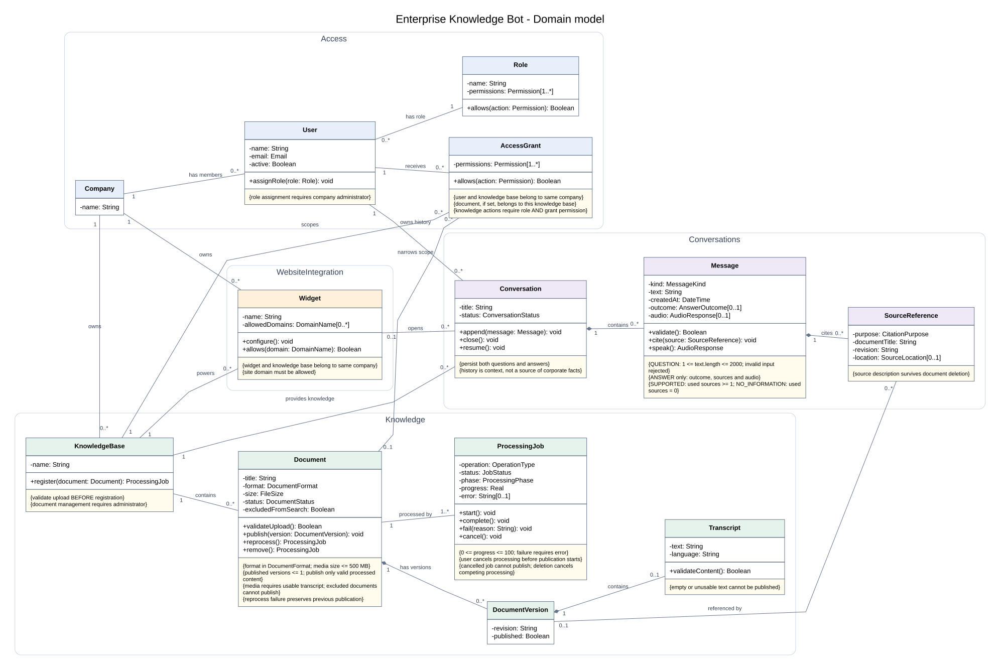

# Задание №6. Концептуальная диаграмма классов

**Задание:** показать сущности предметной области, их характеристики, предметные операции и связи без технической детализации. Модель основана на работах команды по заданиям 1–2 и лекции о доменном моделировании.

Имена классов, атрибутов, операций, типов, значений и ограничений приведены на английском. Пояснения остаются на русском. Язык имён не задан UML: русский вариант допустим, английский выбран по пожеланию автора задания.

## Файлы и представления

| Лист draw.io | SVG | Содержимое |
|---|---|---|
| Domain model | [Основная UML-диаграмма](diagrams/domain-classes.svg) | **13 доменных классов, 18 связей** |
| Value objects | [Объекты-значения](diagrams/domain-values.svg) | **5 объектов-значений**, используемых в свойствах основной модели |
| Enumerations | [Перечисления](diagrams/domain-enums.svg) | **10 перечислений** допустимых значений |

[Открыть редактируемый файл draw.io](diagrams/domain-classes.drawio): **Файл → Открыть из → Устройство**. Внутри три листа с названиями из таблицы. Классы, секции и соединители — обычные редактируемые фигуры, а не HTML-таблицы. SVG основной модели соответствуют листу **Domain model**, а не всей совокупности листов.

Объекты-значения и перечисления вынесены отдельно, поэтому основная схема показывает ответственность домена без десятков вспомогательных блоков. Это не исключение правил из модели: типы явно указаны в атрибутах, их структура и ограничения доступны на соседних листах. Единый редактируемый источник — файл `domain-classes.drawio`. Три SVG соответствуют его листам и предназначены для просмотра без редактора.

## Четыре правила лекции

| Правило | Применение |
|---|---|
| Именование | Классы названы существительными в единственном числе и PascalCase: Company, Document, ProcessingJob, SourceReference. Свойства и операции используют camelCase; значения перечислений — UPPER_SNAKE_CASE. Суффиксы DTO, Data, Entity не применяются |
| Атрибут или класс | name и text остаются String. email: Email, size: FileSize, location: SourceLocation и audio: AudioResponse — структурированные значения с собственными ограничениями. DomainName используется и для почты, и для виджета. Закрытые наборы допустимых значений оформлены как enumeration |
| Отсутствие дублирования | Текст и время определены один раз в Message; QUESTION/ANSWER различаются MessageKind и ограничениями, а не копиями классов. Разные форматы не дублируют структуру Document. Role и AccessGrant используют один Permission для разных областей ответственности |
| Явность правил | Методы имеют видимость, параметры и результат; состояние и формат типизированы; математические и логические условия записаны в `{…}`. Правила обработки, отмены, источников, доступа и виджета видны непосредственно на соответствующем листе |

**Обозначения:** `-` — закрытый атрибут, `+` — открытая предметная операция. Атрибут записан как `name: Type`, операция — как `operation(parameter: Type): ReturnType`. Примитивы String, Boolean, Real, Integer, DateTime и Duration описывают виды значений, а не язык программирования. Duration — позиция относительно начала медиафайла.

Линия без стрелки — ассоциация. Закрашенный ромб у целого — композиция. `1` — ровно один, `0..1` — необязательное одиночное значение, `0..*` — любое количество, `1..*` — хотя бы один. Для свойств аналогичная кратность записана в квадратных скобках. Цвет и подписанная рамка обозначают предметную группу.

Наследование, агрегация, интерфейсы и зависимости не добавлены ради демонстрации всех видов стрелок: в выбранном объёме достаточно ассоциаций и композиций. Администратор — роль пользователя. Одна структура Message с MessageKind выбрана вместо отдельной иерархии Question/Answer: общие свойства не повторяются, а специфические правила сформулированы условными ограничениями.

## Доменные классы

| Группа | English | Русское понятие | Ответственность |
|---|---|---|---|
| Access | Company | Организация | Владеет пользователями, знаниями и виджетами |
| Access | User | Пользователь | Имеет электронный адрес и роль, ведёт историю диалогов |
| Access | Role | Роль | Определяет, какие действия разрешены пользователю |
| Access | AccessGrant | Предоставленный доступ | Определяет разрешённые действия с конкретной базой либо её документом |
| Knowledge | KnowledgeBase | База знаний | Регистрирует материалы и объединяет документы |
| Knowledge | Document | Документ | Проверяет допуск, управляет публикацией, актуализацией и исключением из поиска |
| Knowledge | DocumentVersion | Версия документа | Представляет конкретную редакцию, подготовленную к использованию |
| Knowledge | Transcript | Транскрипция | Содержит пригодный текст речи соответствующей версии медиа |
| Knowledge | ProcessingJob | Задание обработки | Фиксирует операцию, состояние, этап, прогресс и ошибку; допускает отмену |
| Conversations | Conversation | Диалог | Сохраняет последовательность сообщений, закрывается и возобновляется |
| Conversations | Message | Сообщение | Представляет вопрос или ответ; проверяет текст, обоснование, источники и озвучивание |
| Conversations | SourceReference | Ссылка на источник | Сохраняет использованный/проверенный источник, версию и необязательное положение фрагмента |
| WebsiteIntegration | Widget | Виджет | Использует базу своей организации и проверяет разрешённые домены внешнего сайта |

Все девять исходных сущностей глоссария сохранены. Четыре уточнения — AccessGrant, DocumentVersion, SourceReference и Widget — следуют из BR2, BR8, BR10, BR13. Аудиоверсия — значение AudioResponse внутри Message, а не самостоятельный сервис или объект хранения.

## Объекты-значения и перечисления

`«valueObject»` — принятая в этой модели пометка структурированного значения без самостоятельной бизнес-идентичности; она не требует отдельной таблицы или сервиса. У Email непустая локальная часть и корректный DomainName. FileSize неотрицателен, но ограничение 500 МБ накладывает Document только на медиа. SourceLocation задаёт раздел, страницу или временную позицию; конец интервала требует начало и не предшествует ему. AudioResponse соответствует снимку текста выданного ответа.

Перечисления представлены на листе **Enumerations** и используются в типах атрибутов основной схемы:

| Тип | Использование |
|---|---|
| DocumentStatus | Document.status |
| JobStatus | ProcessingJob.status |
| ConversationStatus | Conversation.status |
| DocumentFormat | Document.format |
| OperationType | ProcessingJob.operation |
| ProcessingPhase | ProcessingJob.phase |
| MessageKind | Message.kind |
| AnswerOutcome | Message.outcome; только у ANSWER |
| CitationPurpose | SourceReference.purpose |
| Permission | Role.permissions и AccessGrant.permissions |

**Role и AccessGrant решают разные задачи:** роль — допустимые действия, доступ — область знаний, где они применимы. Для работы с материалом нужны оба разрешения и принадлежность одной организации. Администрирование пользователей и виджета проверяется по роли. Доступ к документу сужает область конкретного разрешения; он не отменяет уже предоставленный доступ к базе целиком. Индивидуальные запреты не определены требованиями.

## Кратности и владение

- User, KnowledgeBase и Widget принадлежат одной Company; у неё их может быть `0..*`. У пользователя одна Role; назначение выполняет администратор своей компании.
- AccessGrant выдан одному User и относится к одной KnowledgeBase; необязательный Document должен принадлежать этой базе. Если Document отсутствует, область — вся база.
- Document зарегистрирован в одной KnowledgeBase; у него `0..*` подготовленных DocumentVersion и `1..*` ProcessingJob. Первое задание создаётся при регистрации документа, последующие попытки — новые задания.
- Document владеет версиями, версия — `0..1` Transcript. До успешной подготовки версий может не быть; для публикации медиа пригодная транскрипция обязательна.
- Conversation принадлежит одному User, использует одну KnowledgeBase и владеет `0..*` Message. При удалении диалога его сообщения и SourceReference удаляются, документы базы остаются.
- SourceReference принадлежит одному Message. Только ANSWER может иметь ссылки. У ссылки `0..1` живой первоисточник DocumentVersion: после удаления остаются название и обозначение версии в истории, но открытие удалённого содержимого не гарантируется.
- Widget использует одну KnowledgeBase; Conversation открыт через `0..1` Widget или основной чат. Несколько виджетов могут использовать одну базу.

KnowledgeBase — Document и Document — ProcessingJob оставлены ассоциациями: каскадное уничтожение базы не задано, а результат задания может требоваться после удаления содержимого. Композиция применяется там, где часть принадлежит единственному целому и не имеет самостоятельного смысла.

## Ключевые инварианты

| Объект / операция | Правило | Основание |
|---|---|---|
| KnowledgeBase.register(), Document.validateUpload() | Допуск проверяется до регистрации: разрешённый DocumentFormat; для MP3/WAV/MP4 FileSize <= 500 МБ | FR-02.1, AC-02.1 |
| Document.publish() | Успешная обработка, пригодная транскрипция медиа, документ не исключён; опубликовано не более одной версии | BR1, BR4–BR8, AC-02.2 |
| Document.reprocess() | Прежняя публикация обслуживает запросы до успешной замены. Сбой не удаляет рабочую версию | BR8, процессы №3 |
| Document.remove(), ProcessingJob.cancel() | Исключение из поиска запрещает новые ответы и повторную публикацию; удаление отменяет конкурентную обработку | BR7 |
| ProcessingJob | Прогресс от 0 до 100, ошибка имеет причину, этап наблюдаем. Пользователь отменяет первичную/повторную обработку до начала публикации | BR15, AC-02.3 |
| Message.validate() | QUESTION имеет 1–2000 символов; недопустимый вопрос не принимается. outcome, sources и audio существуют только у ANSWER | AC-01.1, BR10, BR14 |
| Message.cite() | SUPPORTED требует хотя бы один USED-источник; NO_INFORMATION не имеет USED-источников. CHECKED-ссылки фиксируют проверенные материалы | BR9, BR10, AC-01.2 |
| Conversation.append() | Вопрос и ответ сохраняются; история — контекст, а не первоисточник корпоративных фактов | AC-01.3, BR12 |
| Message.speak(), AudioResponse | Аудиоверсия соответствует снимку текста конкретного ответа; сбой TTS не отменяет текст | BR14 |
| Widget | Своя организация и база; разрешённый домен внешнего сайта | BR13, NFR-03.1 |

Ограничения определяют допустимые экземпляры Message: простое наличие свойства audio в объявлении класса не разрешает его у вопроса. Это обеспечивает условие `{ANSWER only: outcome, sources and audio}`. Все корпоративные факты подтверждаются материалами; NO_INFORMATION и CHECK_FAILED — разные исходы.

## Проверка критериев приёмки

| AC | Отражение в модели | Проверка за пределами доменной структуры |
|---|---|---|
| AC-01.1 | Message.validate(), длина QUESTION 1–2000 | Блокировка кнопки, текст подсказки и отсутствие HTTP-запроса |
| AC-01.2 | SUPPORTED, SourceReference, DocumentVersion, ограничения публикации | Конкретный тестовый регламент и потоковое отображение |
| AC-01.3 | Композиция истории и Conversation.append() | Индикатор печати |
| AC-02.1 | DocumentFormat, FileSize, validateUpload() до register() | Отказ загрузки и текст уведомления |
| AC-02.2 | Transcript, DocumentVersion, состояние и этап ProcessingJob, publish() | Тестовый файл и длительность выполнения |
| AC-02.3 | Прогресс 0–100, cancel(), CANCELLED и запрет последующей публикации | Вид прогресс-бара; физическая запись выражена предметным началом публикации |
| AC-03.1 | Widget связан со своей Company и KnowledgeBase | HTML-инициализация; кнопка справа снизу без перекрытия основного контента — требования к интерфейсу |
| AC-03.2 | Не добавляет доменных полей | Независимость оформления от CSS внешнего сайта — требование к интерфейсу |
| AC-03.3 | Не добавляет доменных полей | Полноэкранный режим при ширине < 768 — требование к интерфейсу; gzip-бандл <= 200 КБ — ограничение сборки |

Положение кнопки, мобильный режим и изоляция стилей относятся к требованиям интерфейса виджета и не моделируются полями Widget. Группа WebsiteIntegration означает интеграцию с внешним сайтом и не связана с векторными эмбеддингами.

Параметры протоколов, сетевые вызовы, устройство очереди, хранилищ и размер JS-бандла в классы не включены. Доменные ограничения AC видимы на схеме; интерфейсные и технические проверки явно перечислены отдельно.

## Допущения и согласование

1. Приняты одна организация и одна роль User, одна база Conversation и Widget; организация может иметь несколько баз. Анонимные посетители и множественное членство исходными моделями не определены.
2. Состояния из №7 переведены на английский без изменения смысла. DocumentStatus.CANCELLED означает отменённую первичную обработку, а не удаление документа. При отмене переиндексации старая версия сохраняется и документ возвращается к INDEXED.
3. JobStatus.CANCELLED и состояние отменённой первичной обработки уточняют пробел между AC-02.3 и диаграммами №7. Следует согласовать соответствующие переходы с автором №7; его файлы здесь не изменяются. Новая попытка создаёт новое задание.
4. complete() зависит от OperationType: успешное DELETE не публикует документ. Ошибка переиндексации фиксируется в задании и не лишает Document рабочей публикации.
5. BR2 описывает доступ к отдельным документам, тогда как процесс №3 проверяет базу. AccessGrant моделирует оба уровня; процесс потребуется уточнить.
6. TXT/MD сохранены по Vision & Scope, хотя сообщение об ошибке AC-02.1 их не перечисляет. Изображения не добавлены: FR и разрешённый перечень их не включают.
7. Уникальность и подтверждение Email не заданы; они не добавлены. Детальная грамматика проверки адресов и доменов остаётся предметом дальнейшей спецификации.
8. Алгоритмы разбиения материалов, параметры поиска, API и структуры хранения относятся к реализации. Группы классов лишь предлагают будущие границы ответственности.

## Основа модели

Изучены все текстовые материалы заданий 1 и 2, имеющиеся в `main` на коммите `2e33a5c889e7cab875ba5fbb336410595a4a5bb2`:

| Материал | Что использовано |
|---|---|
| [Vision & Scope](https://github.com/adsfryt/AI-chat-knowledge-bot/blob/2e33a5c889e7cab875ba5fbb336410595a4a5bb2/1-task/1/Readme.md) | Границы системы, история, мультимедийные материалы, TTS, виджет |
| [Прецеденты](https://github.com/adsfryt/AI-chat-knowledge-bot/blob/2e33a5c889e7cab875ba5fbb336410595a4a5bb2/1-task/2/Readme.md) | Пользователь, администратор, их цели и внешние AI-сервисы |
| [Диаграммы деятельности](https://github.com/adsfryt/AI-chat-knowledge-bot/blob/2e33a5c889e7cab875ba5fbb336410595a4a5bb2/1-task/3/README.md) | Публикация версий, источники, удаление, повторная обработка, снимок текста для озвучивания |
| [Термины, правила и сущности](../../1-task/4/task.md) | Все девять исходных сущностей; правила BR1–BR15 (пункты 1–15 раздела 4.2) |
| [User Stories и требования](https://github.com/adsfryt/AI-chat-knowledge-bot/blob/2e33a5c889e7cab875ba5fbb336410595a4a5bb2/2-task/5/README.md) | US-01: вопрос и ответ; US-02: обработка медиа; US-03: виджет и разрешённые домены |
| [Диаграммы состояний](https://github.com/adsfryt/AI-chat-knowledge-bot/blob/2e33a5c889e7cab875ba5fbb336410595a4a5bb2/2-task/7/README.md) | Состояния Документа, Задания обработки и Диалога |

Также проверены общие README заданий и исходники трёх диаграмм состояний. Начальный набросок проекта использован как контекст; формализованные материалы имеют приоритет. Ссылки на командные работы закреплены на изученном коммите: истории `roman` и `main` различаются, поэтому содержимое чужих заданий сюда не копируется.

Дополнительная методическая основа — предоставленная лекция **«4. Доменное моделирование: от текста к бизнес-сущностям»**, 27 слайдов. По слайдам 14–16 показаны атрибуты и предметные операции; по слайдам 18–21 различены ассоциация и композиция, наследование вводится только при необходимой специализации; в упрощённой модели вопрос и ответ различаются типом MessageKind; по слайдам 23–24 классы названы существительными, структурированные понятия выделены отдельно, ограничения вынесены на диаграмму; по слайдам 25–26 состояния и операции согласованы с процессами и жизненными циклами. Лекция задаёт подход к моделированию, а требования к продукту берутся из материалов команды.
