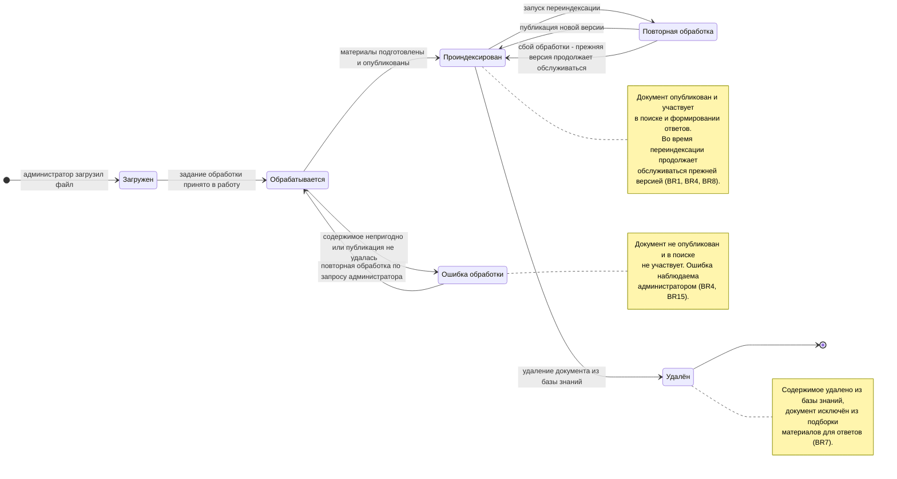
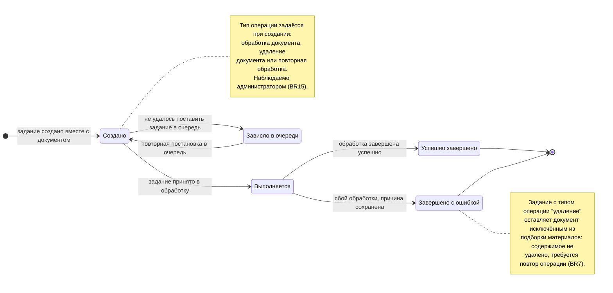
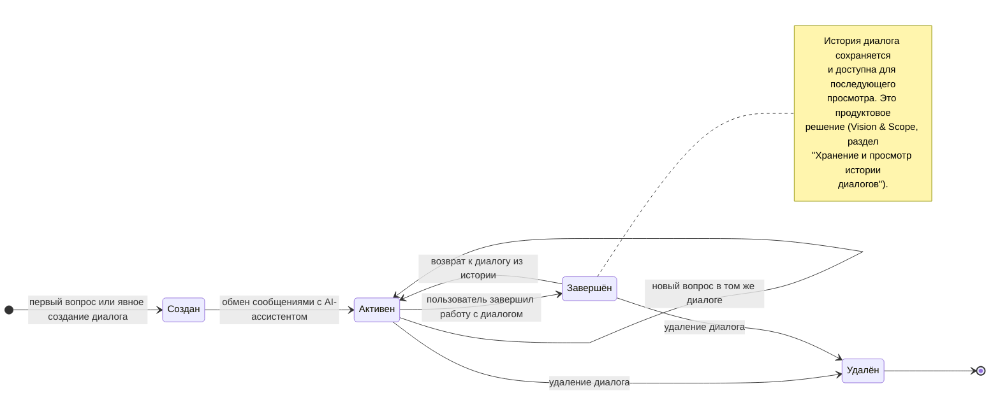

# Задание №7. Диаграммы состояний (State Diagram)

**Автор:** Ваджипов Эмир · ветка `emir` · папка `2-task/7/`
**Основа:** Vision & Scope (`1-task/1/`), UseCase-диаграмма (`1-task/2/`), диаграммы деятельности (`1-task/3/`), глоссарий и бизнес-правила (`1-task/4/task.md`)
**Цель шага:** смоделировать поведение сущностей, обладающих жизненным циклом, — выявить перечень допустимых состояний объекта и правила переходов между ними; результат используется для дальнейшего проектирования и уточнения бизнес-процессов.

## Что сделано

Проанализированы сущности предметной области из `1-task/4/task.md` (раздел 4.3) на предмет наличия жизненного цикла. Жизненный цикл выявлен у трёх сущностей, остальные либо не имеют состояний, либо их состояние вырождено:

| Сущность | Жизненный цикл | Почему выбрана |
|---|---|---|
| **Документ** | есть | Обрабатывается в фоне, публикуется в базе знаний и оттуда участвует или не участвует в поиске |
| **Задание обработки (Job)** | есть | Отражает прогресс фоновой обработки и наблюдается администратором |
| **Диалог** | есть (частично) | Накапливает сообщения, может быть завершён и удалён |
| Транскрипция | нет | Является производным артефактом обработки документа, отдельного состояния не имеет |
| Сообщение | нет | Существует только внутри диалога, состояние не моделируется |
| Организация / Пользователь / Роль / База знаний | нет | В текущем объёме MVP состояния не используются (у пользователя есть только признак активности) |

Построены **3 диаграммы состояний** (`stateDiagram-v2`, Mermaid) — по одной на каждую выбранную сущность:

1. **Документ** — `diagrams/document-state.mmd` (+ `document-state.png`)
2. **Задание обработки** — `diagrams/job-state.mmd` (+ `job-state.png`)
3. **Диалог** — `diagrams/conversation-state.mmd` (+ `conversation-state.png`)

Каждая диаграмма сопровождается таблицей переходов (событие, действие, результат) и привязкой к бизнес-правилам и прецедентам. Диаграммы согласованы с `1-task/3/`: состояния и переходы соответствуют моделям жизненного цикла, зафиксированным в диаграммах деятельности.

---

## Диаграмма 1. Жизненный цикл Документа

### Таблица переходов

| № | Исходное состояние | Событие (триггер) | Целевое состояние | Действия при переходе | Правила |
|---|---|---|---|---|---|
| 1 | — (создание) | Администратор загрузил файл | `Загружен` | Файл принят; создана запись Документа и Задание обработки в статусе `Создано`; документ зарегистрирован в очереди на обработку | BR5, BR11, BR15 |
| 2 | `Загружен` | Задание обработки принято в работу | `Обрабатывается` | Начата фоновая обработка: извлечение содержимого либо транскрипция с последующей проверкой пригодности | BR4, BR15 |
| 3 | `Обрабатывается` | Материалы подготовлены и опубликованы | `Проиндексирован` | Материалы документа опубликованы в базе знаний со ссылкой на метаданные документа и организации; документ становится доступным для поиска | BR1, BR4 |
| 4 | `Обрабатывается` | Содержимое непригодно или публикация не удалась | `Ошибка обработки` | Сохранена причина ошибки; документ не опубликован и в поиске не участвует; администратору доступен статус | BR4, BR15 |
| 5 | `Ошибка обработки` | Повторная обработка по запросу администратора | `Обрабатывается` | Создано новое задание обработки; предыдущая ошибка сохраняется в истории заданий | BR8, BR15 |
| 6 | `Проиндексирован` | Запуск переиндексации | `Повторная обработка` | Создано задание обработки; прежняя опубликованная версия продолжает обслуживать запросы, новая готовится отдельно | BR8, BR15 |
| 7 | `Повторная обработка` | Публикация новой версии | `Проиндексирован` | Новая версия опубликована целиком, прежняя заменена — смешения версий не происходит | BR8 |
| 8 | `Повторная обработка` | Сбой обработки | `Проиндексирован` | Ошибка зафиксирована на задании; прежняя версия продолжает обслуживаться, работоспособность документа не теряется | BR8, BR15 |
| 9 | `Проиндексирован` | Удаление документа из базы знаний | `Удалён` | Активные задания документа отменены; документ исключён из подборки материалов; содержимое удалено | BR7, BR15 |
| 10 | `Удалён` | — | — | Конечное состояние: документ не участвует в формировании новых ответов | BR7 |

### Ключевые свойства жизненного цикла

* **Публикация — единственная точка, в которой документ становится доступен для поиска.** Из состояний `Загружен`, `Обрабатывается` и `Ошибка обработки` документ в выдачу не попадает (**BR1, BR4**).
* **Состояние `Повторная обработка` — рабочее, а не дефектное.** Оно показывает незавершённость обновления администратору, но не выводит документ из обслуживания: ранее опубликованная версия продолжает отвечать на запросы (**BR8**). Это расходится с состоянием `Ошибка обработки`, где публикации не было вовсе.
* **Сбой переиндексации не отнимает у пользователя рабочий материал.** Переход `Повторная обработка → Проиндексирован` при сбое — это возврат к прежней версии, а не откат в неопубликованное состояние (**BR8**).
* **Возврат из `Ошибка обработки` возможен только через `Обрабатывается`.** «Мёртвого» состояния нет: любой сбой устраним повторной обработкой (**BR8**).
* **`Удалён` — тупиковое состояние.** Из него переходов нет, что гарантирует невозвратность удаления (**BR7**).

---

## Диаграмма 2. Жизненный цикл Задания обработки

### Таблица переходов

| № | Исходное состояние | Событие (триггер) | Целевое состояние | Действия при переходе | Правила |
|---|---|---|---|---|---|
| 1 | — (создание) | Загрузка документа администратором | `Создано` | Задание создано одновременно с документом; задан тип операции | BR15 |
| 2 | `Создано` | Задание принято в обработку | `Выполняется` | Начата фоновая обработка документа | BR4, BR15 |
| 3 | `Создано` | Очередь обработки недоступна | `Зависло в очереди` | Сохранена причина сбоя постановки; документ остаётся в статусе `Загружен` и не обрабатывается | BR15 |
| 4 | `Зависло в очереди` | Повторная постановка в очередь | `Создано` | Задание возвращается в очередь; после принятия в обработку переходит в `Выполняется` | BR15 |
| 5 | `Выполняется` | Обработка завершена успешно | `Успешно завершено` | Связанный документ переведён в `Проиндексирован` | BR1, BR4 |
| 6 | `Выполняется` | Сбой обработки | `Завершено с ошибкой` | Сохранена причина сбоя; связанный документ переведён в `Ошибка обработки` | BR15 |
| 7 | `Выполняется` | Удаление документа завершено | `Успешно завершено` | Содержимое документа удалено; документ исключён из подборки материалов | BR7 |
| 8 | `Успешно завершено` / `Завершено с ошибкой` | — | — | Конечные состояния: результат зафиксирован, задание не меняется | — |

### Ключевые свойства жизненного цикла

* **Состояние задания и состояние документа связаны.** Задание — «рабочая оболочка» операции: терминальное состояние задания определяет состояние документа (`Успешно завершено` → `Проиндексирован`, `Завершено с ошибкой` → `Ошибка обработки`) (**BR15**).
* **Тип операции — часть задания, а не отдельной сущности.** Обработка документа, повторная обработка и удаление оформлены заданием одного типа с разным типом операции. Благодаря этому удаление отменяет активные задания документа и не может быть «перебито» уже выполняющейся обработкой (**BR7**).
* **Состояние `Зависло в очереди` — техническое, но обязательное.** Оно отражает реальную ситуацию: документ принят, но инфраструктура очередей недоступна, поэтому обработка не началась. Без него документ «зависает» в `Загружен` без объяснения — администратор не видит причину (**BR15**).
* **Задание — сущность с аудитом.** Причина сбоя сохраняется в самом задании, поэтому состояние `Завершено с ошибкой` не теряет диагностическую информацию.

---

## Диаграмма 3. Жизненный цикл Диалога

### Таблица переходов

| № | Исходное состояние | Событие (триггер) | Целевое состояние | Действия при переходе | Правила |
|---|---|---|---|---|---|
| 1 | — (создание) | Первый вопрос пользователя или явное создание | `Создан` | Создана запись диалога; заголовок формируется из первого сообщения | BR12 |
| 2 | `Создан` | Начало обмена сообщениями | `Активен` | Вопрос и ответ ассистента сохраняются в диалоге; к ответу привязываются источники | BR10, BR12 |
| 3 | `Активен` | Новый вопрос в том же диалоге | `Активен` | Контекст диалога учитывается при формировании ответа; сообщения накапливаются | BR12 |
| 4 | `Активен` | Пользователь завершил работу | `Завершён` | Диалог перестаёт быть активным, но остаётся в истории | BR12 |
| 5 | `Завершён` | Возврат к диалогу из истории | `Активен` | Обмен сообщениями продолжается с сохранённым контекстом | BR12 |
| 6 | `Активен` / `Завершён` | Удаление диалога | `Удалён` | Запись и связанные сообщения удаляются | — |
| 7 | `Удалён` | — | — | Конечное состояние | — |

### Ключевые свойства жизненного цикла

* **`Завершён` — обратимое состояние.** Завершение диалога не означает его уничтожения: из истории диалог можно открыть и продолжить.
* **Сохранение истории — продуктовое решение**, а не следствие BR12: правило сформулировано разрешительно («сообщения **могут** сохраняться»), а обязанность хранить историю задана границами проекта (Vision & Scope, §3).
* **`Удалён` — единственное необратимое состояние.** В отличие от документа, удаление диалога не требует удаления содержимого из хранилища материалов — удаляется сама переписка.
* **Диалог не влияет на состояние базы знаний.** Удаление диалога не влияет на проиндексированные документы, и наоборот: удаление документа не закрывает диалоги, в которых он цитировался (ссылки на источники остаются в истории сообщений).

---

## Соответствие состояний реализации

Диаграммы отражают модель предметной области; в текущей реализации состояния хранятся в полях `status` (Документ, Задание) и выводятся в админ-панели:

| Сущность | Состояние на диаграмме | Значение в БД | Где отображается |
|---|---|---|---|
| Документ | `Загружен` | `queued` | Статус в списке админ-панели, автообновление каждые 3 с |
| Документ | `Обрабатывается` | `processing` | То же |
| Документ | `Проиндексирован` | `ready` | То же |
| Документ | `Ошибка обработки` | `failed` + текст ошибки | То же, отдельная колонка «Ошибка» |
| Документ | `Повторная обработка` | отдельного значения нет — сейчас переиндексация не реализована | — |
| Документ | `Удалён` | запись удаляется | — |
| Задание | `Создано` | `queued`, progress = 0 | Endpoint статуса задания, админ-панель |
| Задание | `Выполняется` | `processing`, progress 5→30→70 | То же |
| Задание | `Успешно завершено` | `ready`, progress = 100 | То же |
| Задание | `Завершено с ошибкой` | `failed` + причина | То же |
| Задание | `Зависло в очереди` | `queued` + текст ошибки постановки | То же |
| Диалог | `Создан` / `Активен` / `Завершён` | запись в `conversations` (отдельного поля статуса нет) | Список диалогов истории, счётчик сообщений |
| Диалог | `Удалён` | запись удаляется | — |

**Что ещё не реализовано и требует доработки** (зафиксировано как выявленное расхождение модели и реализации):

1. Отдельного поля статуса у **Диалога** нет — состояния `Активен`/`Завершён` выводятся из наличия сообщений и последней активности. Для полноценной модели нужно добавить `status` в `conversations`.
2. **Переиндексация** документа (`Проиндексирован → Повторная обработка → Проиндексирован`) и **удаление** документа (`Проиндексирован → Удалён`) в текущем API отсутствуют — есть только загрузка и просмотр статусов. Переходы описаны в модели и требуют реализации операций `reindex` и `delete` в админ-панели.
3. **Тип операции у задания** в реализации отсутствует — задание сейчас только обслуживает обработку документа. Для модели из задания 7 требуется хранить тип операции, чтобы удаление оформлялось заданием и отменяло активные задания документа.
4. Повторная обработка документа из состояния `Ошибка обработки` в UI не запускается — требуется действие «повторить» у документа со статусом `failed`.

---

## Трассируемость

| Диаграмма состояний | Прецеденты Use Case (`1-task/2/diagram.png`) | Диаграммы деятельности (`1-task/3/README.md`) | Бизнес-правила (`1-task/4/task.md`) | Сущности (`1-task/4/task.md`, п. 4.3) |
|---|---|---|---|---|
| **Документ** | `Загрузить документ в базу знаний`, `Удалить документ из базы знаний` | Диаграмма 2 (загрузка и обработка), Диаграмма 3 (актуализация и удаление) | BR1, BR4, BR5, BR7, BR8, BR11, BR15 | Документ |
| **Задание обработки** | `Загрузить документ в базу знаний`, `Запустить переиндексацию базы знаний`, `Удалить документ из базы знаний` | Диаграмма 2 (загрузка и обработка), Диаграмма 3 (актуализация и удаление) | BR4, BR7, BR15 | Задание обработки (Processing Job) |
| **Диалог** | `Задать вопрос`, `Просмотреть историю диалогов` | Диаграмма 1 (ответ на вопрос) | BR12 | Диалог (Conversation), Сообщение (Message) |

---

## Формат и нотация

* Нотация — UML-подобная диаграмма состояний в Mermaid (`stateDiagram-v2`); исходники лежат в `diagrams/*.mmd`, отрисованные версии — `diagrams/*.png`.
* `[*]` — начальное и конечное состояние; `state "Подпись" as id` — именованное состояние.
* Подпись перехода (`--> : текст`) — событие-триггер, вызывающий переход; пояснения вынесены в таблицы переходов.
* `note` — комментарий, фиксирующий бизнес-ограничение, действующее в состоянии.
* Названия состояний совпадают с терминологией глоссария `1-task/4/task.md` (п. 4.4) и с состояниями, используемыми в диаграммах деятельности `1-task/3/`.
* Диаграммы построены на уровне предметной области: без указания конкретных технологий, библиотек и внутренних форматов хранения.
